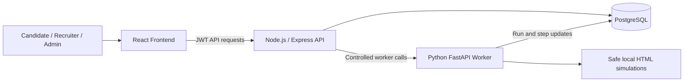

# HirePilot AI — AI Recruitment Automation Platform

HirePilot AI is a full-stack recruitment workflow platform for candidates, recruiters, and platform administrators. It combines profile and resume intelligence, job matching, recruiter hiring workflows, governed external-job discovery, and a safe local automation foundation in one role-based application.

The current repository is a development and portfolio-ready foundation. External discovery and browser automation are intentionally limited to local demo content and simulations; production deployment and real external-portal integrations are not complete.

## Product roles

### Candidate

Candidates maintain a professional profile and resume, review matched internal and approved external jobs, track applications, handle manual fallbacks, view interviews and notifications, and inspect AI-agent run progress.

### Recruiter

Recruiters maintain a company profile, publish jobs after admin approval, review ranked applicants, inspect candidate profiles and resumes, shortlist or reject applicants, and manage interviews.

### Admin

Admins govern recruiter access, verify recruiter companies, manage the external-source allowlist, run the safe Crawl4AI demo discovery operation, and approve, hide, reject, or return discovered jobs to pending review.

## Core features

- JWT authentication and role-based access control (RBAC)
- Candidate profile completion and PDF resume parsing
- ATS score and AI-assisted job matching
- Recruiter job posting with admin approval enforcement
- Applicant ranking, candidate preview, shortlist, and rejection workflows
- Interview scheduling, rescheduling, cancellation, and candidate notifications
- Internal and external application tracking
- Candidate Application Control Center with pending manual actions
- External job discovery simulation and source preview
- Crawl4AI safe raw-HTML demo discovery
- Playwright safe dummy browser-apply flow
- Manual fallback and candidate completion workflow
- AI Agent Timeline with steps, status filters, retry, and cancel controls
- Admin recruiter approval and blocking
- Admin external-source allowlist and trust controls
- Admin external-job moderation
- Recruiter company profiles and admin company verification
- Verified Employer and Reviewed by HirePilot trust indicators

## Technology stack

| Layer | Technology |
| --- | --- |
| Web application | React, React Router, Axios |
| API | Node.js, Express |
| Database | PostgreSQL |
| Authentication | JWT, bcrypt |
| Resume processing | Multer, `pdf-parse` |
| AI worker | Python, FastAPI, Uvicorn |
| Safe browser foundation | Playwright with local dummy HTML |
| Safe discovery foundation | Crawl4AI with raw local HTML |

## Architecture overview



The browser never connects directly to PostgreSQL or the Python worker. The Express API authenticates users, enforces roles, owns business workflows, and coordinates worker requests. PostgreSQL stores users, profiles, jobs, applications, interviews, notifications, external-source governance, and agent-run history.

See [Architecture](docs/ARCHITECTURE.md) for data-flow and safety details.

## Quick start

### Prerequisites

- Node.js and npm
- Python 3.10 or newer
- PostgreSQL and `psql`
- A local database containing HirePilot's core schema

> The numbered migrations in this checkpoint are additive. They expect the original core tables—such as `users`, `candidates`, `jobs`, `applications`, `interviews`, and `notifications`—to exist before migration `001` is applied.

### 1. Install dependencies

```powershell
# Backend dependencies are defined at repository root
npm install

cd frontend
npm install
cd ..

cd ai-agent
python -m venv venv
.\venv\Scripts\Activate.ps1
pip install -r requirements.txt
python -m playwright install chromium
crawl4ai-setup
cd ..
```

### 2. Configure local environment

Copy `backend/.env.example` to `backend/.env` and replace every placeholder locally. Never commit the resulting `.env` file.

```powershell
Copy-Item backend/.env.example backend/.env
```

For worker-backed demo flows, also configure placeholder-safe worker settings described in the [Setup Guide](docs/SETUP_GUIDE.md).

### 3. Apply database migrations

After the core schema exists, apply `database/migrations/001_*.sql` through `011_*.sql` in filename order.

```powershell
Get-ChildItem database/migrations/*.sql |
  Sort-Object Name |
  ForEach-Object { psql -U postgres -d hirepilot_db -f $_.FullName }
```

### 4. Start the services

Open three terminals from the repository root.

AI worker:

```powershell
cd ai-agent
.\venv\Scripts\Activate.ps1
uvicorn main:app --reload --port 8000
```

Backend API:

```powershell
cd backend
node server.js
```

Frontend:

```powershell
cd frontend
npm start
```

Then open `http://localhost:3000`. Service checks:

- Backend: `http://localhost:5000/`
- AI worker: `http://127.0.0.1:8000/health`

For database provisioning, environment placeholders, admin setup, Linux/macOS commands, and troubleshooting, see the [Setup Guide](docs/SETUP_GUIDE.md).

## Demo health check

After starting all three services, run the read-only local readiness check:

```powershell
powershell -ExecutionPolicy Bypass -File .\scripts\demo-health-check.ps1
```

It reports clear **PASS**, **WARN**, and **FAIL** results for the backend, AI worker, optional queue statistics, and frontend. It does not modify files or the database and does not contact an external website.

- [Health check usage and safety](scripts/demo-health-check.md)
- [Fast E2E Demo Checklist](docs/E2E_DEMO_CHECKLIST.md)

## Demo accounts

The following are examples only; they are not guaranteed to be seeded:

| Role | Email | Password |
| --- | --- | --- |
| Candidate | `candidate@example.com` | `password` |
| Recruiter | `recruiter@example.com` | `password` |
| Admin | `admin@example.com` | `password` |

Use synthetic identities and resumes for screenshots or public demos. Follow the [Demo Guide](docs/DEMO_GUIDE.md) to prepare the roles in a safe order.

## Safety and scope

- Crawl4AI discovery uses a hardcoded raw local HTML document containing three demo jobs.
- The Crawl4AI demo does not crawl LinkedIn, Indeed, company career pages, or any real website.
- Playwright automation targets a safe dummy form and does not submit real external applications.
- Simulated LinkedIn and Indeed records use reserved `.example` references and are not live integrations.
- External source records do not become usable merely because they are created: admins must approve and enable sources.
- Newly discovered demo jobs enter admin review before candidate visibility.
- Manual fallback keeps the candidate in control when an application cannot be completed automatically.
- Do not use real passwords, app passwords, resumes, reset tokens, or production data in demos.

Real allowlisted external-portal support would require explicit source authorization, legal and security review, portal-specific controls, consent, observability, and additional testing. It is roadmap work, not a current capability.

## Public repo safety

This repository is configured to ignore local environment files, dependencies, virtual environments, builds, uploaded resumes, logs, database dumps, and zip archives while keeping `database/migrations/*.sql` trackable. Ignore rules do not remove anything already committed, so review both the current tree and Git history before making a repository public.

- Copy configuration from `backend/.env.example` and keep the real `backend/.env` private.
- Use synthetic accounts, resumes, jobs, and screenshots only.
- Revoke and regenerate any credential that may have been exposed; deleting it from the latest commit is not enough.
- Do not describe the local Crawl4AI or Playwright demonstrations as real external-portal integrations.
- Do not describe the project as production-deployed or production-ready.

Review the [Privacy Checklist](docs/PRIVACY_CHECKLIST.md) and [Deployment Readiness](docs/DEPLOYMENT_READINESS.md) guide before publishing or deploying.

## Current status

Implemented and demo-ready locally:

- Candidate, Recruiter, and Admin tabbed workspaces
- Internal recruitment and interview workflows
- Recruiter and company governance foundations
- External-source allowlist and discovered-job review
- Safe Crawl4AI and Playwright demo foundations
- Candidate application and agent-run tracking
- Loading, empty-state, trust, and role-routing polish

Not yet complete:

- Production deployment and operations hardening
- Real external-portal crawling or application submission
- Production-grade email delivery, rate limiting, validation, monitoring, and automated test coverage
- Full clean-database bootstrap schema in the numbered migration set

## Documentation

- [Architecture](docs/ARCHITECTURE.md)
- [Demo Guide](docs/DEMO_GUIDE.md)
- [E2E Demo Checklist](docs/E2E_DEMO_CHECKLIST.md)
- [Setup Guide](docs/SETUP_GUIDE.md)
- [Features](docs/FEATURES.md)
- [Roadmap](docs/ROADMAP.md)
- [Deployment Readiness](docs/DEPLOYMENT_READINESS.md)
- [Privacy Checklist](docs/PRIVACY_CHECKLIST.md)

## Roadmap

Near-term work focuses on test coverage, configuration cleanup, production hardening, and richer orchestration. Longer-term plans include LangGraph-based workflows, advanced analytics, verified company documents, and carefully governed support for explicitly allowlisted external sources.

See the complete [Roadmap](docs/ROADMAP.md).
