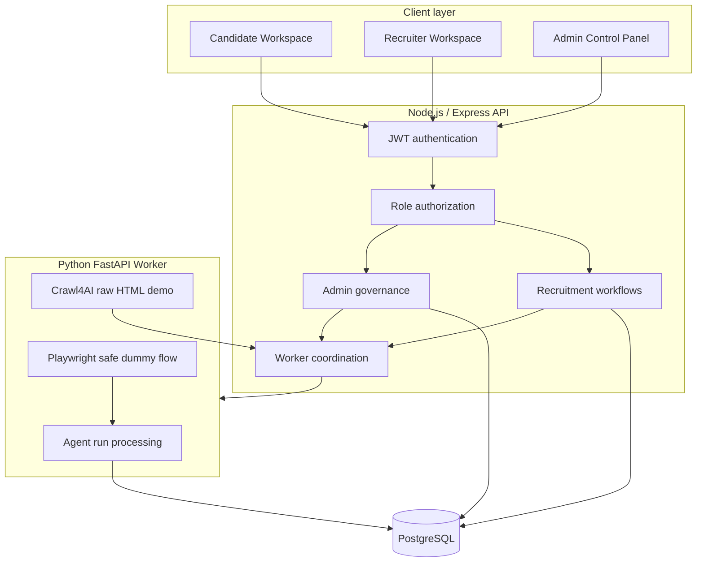
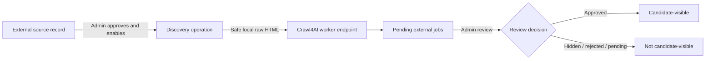

# HirePilot AI Architecture

## 1. System context

HirePilot AI is organized as four cooperating layers:

1. **React frontend** — role-specific Candidate, Recruiter, and Admin workspaces.
2. **Node.js/Express API** — authentication, authorization, recruitment workflows, governance, and worker coordination.
3. **PostgreSQL database** — durable business records and AI-agent audit history.
4. **Python FastAPI worker** — safe discovery and browser-automation foundations plus external-apply run processing.

At a high level, requests move from **Frontend → Backend API → PostgreSQL**, while controlled automation requests move from the **Backend API → AI Worker**. The worker also writes agent-run progress to PostgreSQL. It is not called directly by the browser.

## 2. Frontend

The React application uses role-aware routes:

- `/candidate` — Candidate Workspace
- `/recruiter` — Recruiter Workspace
- `/admin` — Admin Control Panel

JWTs and the authenticated role are stored locally by the current development frontend and attached to API requests. Route guards send unauthenticated users to login and redirect wrong-role navigation to the workspace associated with the stored role.

The dashboards are presentation and workflow clients; they do not connect directly to PostgreSQL and do not call the Python worker directly. This keeps authorization and workflow decisions in the backend.

## 3. Backend API

The Express API listens on port `5000` in the current implementation and mounts routes beneath `/api`.

Its responsibilities include:

- registration, login, password-reset workflow, and JWT issuance;
- candidate profile, resume, job matching, application, interview, and notification workflows;
- recruiter company profile, job publishing, applicant review, ranking, and interview management;
- admin recruiter approval, company verification, source allowlisting, discovery operations, and external-job moderation;
- external-application creation, safe worker dispatch, retry/cancel handling, and manual fallback;
- database reads and writes for business state and audit history.

## 4. PostgreSQL data model

The application uses core recruitment tables plus additive governance and automation tables.

### Core domain

- `users` — identity, password hash, role, and recruiter approval state.
- `candidates` — candidate profile, preferences, resume metadata, and ATS-related fields.
- `jobs` — internally posted recruiter jobs.
- `applications` — candidate applications to internal jobs.
- `interviews` — interview lifecycle data.
- `notifications` — candidate notifications and read state.

### External discovery and automation

- `external_jobs` — simulated or discovered external job records and review state.
- `external_applications` — candidate application state for external jobs.
- `external_sources` — the admin-governed discovery allowlist.
- `agent_attempt_logs` — lower-level external-agent activity records.
- `ai_agent_runs` — one auditable orchestration record per run.
- `ai_agent_run_steps` — ordered progress entries belonging to a run.

### Employer trust

- `recruiter_companies` — one company profile per recruiter with verification status and admin notes.

The numbered migrations `001–011` extend an existing core schema. They should be applied in filename order.

## 5. Authentication and RBAC

The backend signs JWTs containing a user identifier and role. Protected routes first verify the bearer token and then enforce the required role.

| Role | Representative capabilities |
| --- | --- |
| Candidate | Profile, resume, matching, applications, interviews, notifications, agent timeline |
| Recruiter | Company profile, own jobs, own applicants, applicant decisions, interview management |
| Admin | Recruiter status, company verification, sources, discovery, external-job review |

Role checks are distinct from recruiter approval:

- A user must have the `recruiter` role to access recruiter routes.
- A recruiter must also have `recruiter_status = approved` to publish a job.
- Pending or blocked recruiters can still receive a clear account-state notice, but job posting is rejected with HTTP `403`.

Company verification is currently a trust signal rather than a job-posting gate. An approved recruiter may post while the company is pending, but candidates see the appropriate verified, pending, or unverified employer badge.

## 6. External discovery safety model

External discovery is governed in layers:

For the current Crawl4AI foundation:

- the required allowlist key is `crawl4ai_demo`;
- the source must exist, be enabled, and have `trust_status = approved`;
- the operation is development-only and admin-only;
- the worker builds a hardcoded local HTML string containing exactly three demo cards;
- job references use the `crawl4ai-demo://` scheme;
- the backend validates the worker payload before storing it;
- newly discovered jobs are placed into moderation when review columns are available;
- no real external website, login page, or form is contacted.

The simulated LinkedIn and Indeed records are demonstrations only. They do not connect to those platforms and must not be described as live integrations.

## 7. External apply orchestration

The backend supports three external-apply modes:

- `easy_apply` — a simulated straightforward application path;
- `manual_questions` — a workflow that requires candidate action;
- `safe_browser_apply` — Playwright operating only against the safe dummy flow.

When worker execution is enabled, the backend creates an `ai_agent_runs` record and associated ordered steps. The Python worker accepts a safe subset of candidate profile fields, records progress, and returns a controlled outcome.

The safe browser implementation uses an isolated Python child process on Windows so Playwright can use the appropriate subprocess-capable event loop. It fills local dummy HTML only and does not submit to a real portal.

## 8. AI Agent Timeline

The Candidate Workspace presents agent runs latest-first with status filters for all, active, completed, and failed runs. A run can contain states such as queued, running, needs manual action, completed, failed, skipped, or cancelled.

Each run has ordered steps, timestamps, a current step, a summary, and optional error data. Friendly error summaries are shown by default; technical details remain collapsed until requested. Retry and cancel operations continue through authenticated backend endpoints rather than mutating the UI only.

This provides an audit trail for demos and establishes the persistence model needed for richer orchestration later.

## 9. Manual fallback system

Automation is not treated as guaranteed. When questions, unsupported conditions, or a controlled failure prevent completion:

1. The external application remains in a pending/manual state.
2. The agent run records `needs_manual_action` or the appropriate final state.
3. The Candidate Application Control Center highlights the required action and reason.
4. The candidate performs the remaining step manually and explicitly confirms completion.
5. The backend updates the application; the frontend does not fabricate completion.

This design keeps the candidate in control and prevents the demo automation layer from claiming success when it cannot safely complete a workflow.

## 10. Admin governance model

Admin controls form three trust gates:

1. **Recruiter gate** — pending, approved, or blocked recruiter status controls job-publishing access.
2. **Employer gate** — pending, verified, rejected, or needs-review company status drives candidate trust badges and admin notes.
3. **External discovery gate** — source allowlisting controls whether discovery may run, while job moderation controls candidate visibility.

These gates are intentionally separate. Approving a recruiter does not automatically verify its company, and enabling a discovery source does not automatically approve every job it produces.

## 11. Current boundaries

The architecture is suitable for local development and a controlled demonstration. Before production use it still needs deployment infrastructure, comprehensive automated tests, centralized validation and error handling, rate limiting, production email configuration, secret management, monitoring, backup procedures, and a formal policy for any real external-source integration.
